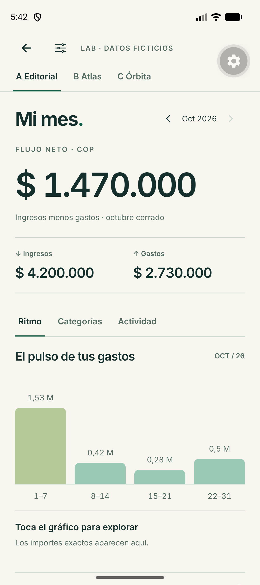
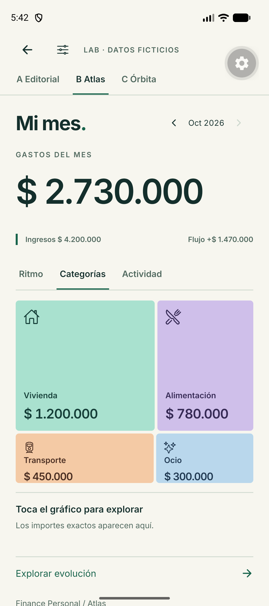
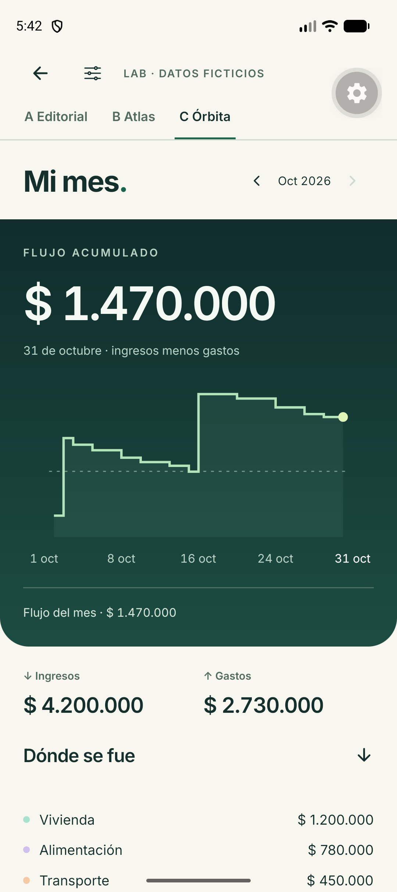

# Tres direcciones para Mi mes

## Diagnóstico de la pantalla actual

La captura del emulador visual2-light muestra un calendario de siete columnas con mucho espacio por celda, una explicación larga y un botón de ancho completo. Debajo aparece Qué cambió y después otra sección de comparación. El usuario debe recorrer varios bloques para reconstruir una sola pregunta sobre su mes.

La implementación de MonthlyOverview también muestra ingresos y gastos en el encabezado, los repite como barras y añade su porcentaje. La falta de jerarquía entre esas representaciones aumenta el recorrido. La comparación con septiembre muestra ceros sin registros y ocupa tanto espacio como una comparación con información suficiente.

La propuesta utiliza una sola visualización protagonista por contexto. El toque revela el importe y el detalle debajo. Actividad, categorías y ritmo comparten espacio. Los periodos sin registros y sin información tienen estados propios.

## A. Editorial

Fondo cálido, cifra principal de flujo neto, tipografía Inter grande, separadores finos y cuatro columnas semanales. Verde salvia y turquesa. La composición utiliza un eje vertical estable y permite cambiar entre ritmo, categorías y actividad.

Ventaja. Es la lectura más rápida y la más fácil de adaptar a tamaños de texto grandes. Se reconoce por la tipografía, el punto turquesa del título y la gráfica integrada en la página.

Coste. Resulta menos llamativa que Atlas a primera vista. Necesita cuidar las proporciones tipográficas para conservar su carácter.

## B. Atlas

El gasto es el protagonista. Cuatro superficies cromáticas forman un mapa proporcional por categoría. El mapa cambia a un calendario de actividad con días de intensidad marcada al seleccionar Actividad.

Ventaja. Da identidad y una lectura inmediata del destino del dinero. Los colores se acompañan de nombres e importes.

Coste. Un mapa proporcional pierde legibilidad al tener muchas categorías pequeñas. Este prototipo tiene cuatro grupos. Una adopción posterior deberá ofrecer lista o agrupación cuando los objetivos táctiles se reduzcan.

## C. Órbita

Una superficie verde profunda atraviesa el ancho de la pantalla. Integra la cifra de flujo acumulado con una línea escalonada que conserva los cambios diarios, incluso el tramo negativo. Debajo aparecen ingresos, gastos y categorías sobre un fondo más tranquilo.

Ventaja. Tiene la mayor continuidad visual entre cifra y gráfico. Los puntos temporales seleccionables explican las variaciones.

Coste. El flujo acumulado exige más interpretación y puede confundirse con saldo disponible. Se rotula explícitamente como ingresos menos gastos. La composición resulta especialmente apropiada para evolución o detalle de una cuenta cuando se use su saldo real.

## Recomendación

Editorial ofrece el mejor punto de partida para Mi mes por su legibilidad y recorrido corto. Atlas puede aportar el lenguaje para Gastos y Órbita el de Evolución y detalle de cuenta. Primero se debe elegir la dirección del producto comparando estas tres pantallas. La galería permite explorarlas sin adoptar aún esa combinación.

## Datos y límites

Las tres variantes comparten una única muestra ficticia en COP. Ingresos de 4.200.000, gastos de 2.730.000 y flujo neto de 1.470.000. Categorías, semanas y días concilian. El flujo diario puede ser negativo. Los tamaños del mapa representan el gasto, descontando el espacio de separación.

Agosto representa una respuesta no disponible. Septiembre representa una respuesta vacía con cero movimientos. Octubre tiene registros. La vista de evolución muestra esos tres estados como filas informativas, evitando una curva con ceros inventados. La API mensual actual entrega totales pero no el conteo de transacciones por tipo. Por tanto, un total cero por sí solo no demuestra ausencia de registros, especialmente cuando existen reversos. Esta galería conserva esa distinción explícitamente en su muestra.

La galería usa React Native, SVG, LinearGradient y las microinteracciones existentes con movimiento reducido. Solo funciona en desarrollo. Se accede desde Catálogo de componentes → Comparar tres direcciones de Mi mes o mediante financepersonalmobile:///design-lab. Tema y privacidad de prueba son locales a la galería. La privacidad global prevalece.

## Capturas y verificación

| Editorial | Atlas | Órbita |
| --- | --- | --- |
|  |  |  |

Capturas reales del emulador Pixel 10. El botón gris flotante pertenece al cliente de desarrollo de Expo. La galería tiene una ruta propia fuera de las pantallas autenticadas para permitir la comparación incluso durante la carga de sesión.

Pasaron TypeScript, ESLint, las 795 pruebas existentes y dos pruebas nuevas de conciliación y distinción de estados. En el emulador se verificaron las tres variantes, el tema oscuro, la selección semanal, el calendario y los periodos sin información. Los controles tienen etiquetas y estado seleccionado, y los importes pueden consultarse mediante texto. La verificación básica de accesibilidad usa la jerarquía Android, sin certificar la experiencia completa con TalkBack.

La medición exploratoria en desarrollo, con renderizado por software, registró 49 fotogramas, 28 fuera de plazo y un percentil 95 de 97 ms. Permite confirmar la ejecución de las interacciones, pero deja pendiente una medición representativa con aceleración gráfica en dispositivo. No se presenta como rendimiento aprobado de producción.

Editorial se revisó visualmente con la fuente del sistema al 140 %. Los importes y controles principales permanecieron legibles. El cambio de escala recreó la actividad Android y Expo mostró una advertencia de configuración múltiple de enlaces. Se pudo reabrir la galería y se restauró la escala original. Esa advertencia del cliente de desarrollo requiere revisión antes de ampliar esta propuesta a producción.

## Referencias

La selección contextual de tiempo y los valores al tocar se contrastaron con [Monzo Trends](https://monzo.com/help/budgeting-overdrafts-savings/trends-months-years-web). La organización por gasto e ingreso se revisó en [Revolut Analytics](https://help.revolut.com/en-US/help/accounts/budget-and-analytics/what-is-the-analytics-dashboard/).

Se revisaron [Watermelon](https://ui.watermelon.sh/), [Spectrum](https://ui.spectrumhq.in/), [shadcn/ui](https://ui.shadcn.com/) y [devl](https://devl.dev/) como referencias de composición y comportamiento. Los prototipos usan componentes nativos propios y las dependencias ya instaladas.
